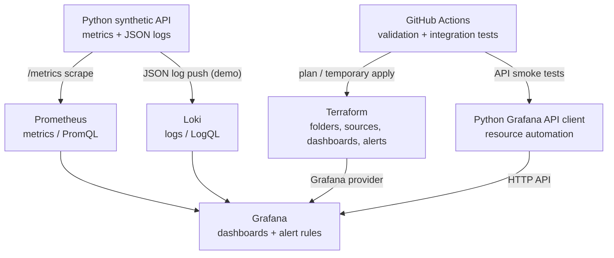

# Observability-as-Code: Automated Grafana Monitoring Platform

> A reproducible observability stack that uses **Terraform, Grafana, Prometheus, Loki, Python, and GitHub Actions** to manage dashboards, data sources, access controls, and alert rules as code.


## Overview

I built this project to demonstrate how an observability platform can be **provisioned, version-controlled, and validated through code** rather than configured manually in the Grafana UI.

The environment runs a synthetic Python service that generates HTTP request metrics and structured logs. **Prometheus** scrapes the metrics, **Loki** stores the logs, and **Grafana** provides dashboards and alert evaluation. I use the **Grafana Terraform Provider** for declarative resource management and a separate **Python API client** for programmatic configuration. A **GitHub Actions** workflow validates the configuration and deploys it to a temporary Grafana instance for integration testing.

This is a **self-contained, local development and integration project**, not a production deployment. The repository intentionally makes the infrastructure and automation visible and easy to reproduce.

## Key features

- **Dashboards as Code:** Grafana dashboards defined in JSON and provisioned through Terraform.
- **Grafana infrastructure with Terraform:** Automated folders, Viewer/Editor folder permissions, Prometheus and Loki data sources, dashboards, and a Grafana-managed alert rule group.
- **Observability signals:** Request throughput, HTTP 5xx error rate, latency histograms, queue depth, and JSON application logs.
- **Grafana API automation:** A Python client creates/updates a separate folder, data source, dashboard, permissions, and an alert rule using Grafana HTTP APIs.
- **Reusable dashboard generation:** A parameterized Jsonnet template generates a dashboard for a named service.
- **Git-based validation:** GitHub Actions checks configuration syntax, runs Terraform validation and plan, and exercises a temporary Grafana instance on pushes to `main`.
- **Failure simulation:** A configurable application error rate makes it possible to observe an alert entering Pending/Firing states.

## Architecture



**Log collection note:** To keep the local setup small, the synthetic application sends JSON logs directly to Loki. A production deployment would ordinarily use **Grafana Alloy** or another supported collector.

## Tech stack

| Component | Technology | Purpose |
| --- | --- | --- |
| Visualization and alerting | Grafana 12 | Dashboards and Grafana-managed alert rules |
| Metrics | Prometheus | Scrape and query application metrics with PromQL |
| Logs | Loki | Store and query structured logs with LogQL |
| Infrastructure as Code | Terraform + Grafana Provider | Declarative configuration and change planning |
| API automation | Python + `requests` | Manage Grafana resources through HTTP APIs |
| Dashboard templating | Jsonnet | Generate reusable dashboard JSON |
| CI | GitHub Actions | Validate and integration-test configuration changes |
| Local runtime | Docker Compose | Run the complete stack on a development machine |

## Repository structure

```text
.
├── .github/
│   └── workflows/
│       └── observability-ci.yml     # CI validation and ephemeral integration deploy
├── api/
│   └── manage_grafana.py            # Grafana HTTP API automation
├── app/
│   ├── app.py                       # Synthetic service, metrics, and log generation
│   ├── Dockerfile
│   └── requirements.txt
├── dashboards/
│   ├── app-overview.json            # Terraform-managed dashboard definition
│   └── reusable.jsonnet            # Parameterized dashboard template
├── loki/
│   └── loki.yaml                   # Loki configuration
├── prometheus/
│   └── prometheus.yml              # Prometheus scrape configuration
├── terraform/
│   └── main.tf                     # Grafana provider and managed resources
├── compose.yaml                    # Local services
└── README.md
```

## Getting started

### Prerequisites

- Docker Engine/Desktop with Compose v2
- Terraform 1.5 or later (compatible 1.x release)
- Python 3.10+ and `pip`
- Git
- Optional: a `jsonnet` CLI for the dashboard generation example

### 1. Start the observability stack

```bash
docker compose up -d --build
docker compose ps
```

| Service | Address | Expected result |
| --- | --- | --- |
| Grafana | http://127.0.0.1:3000 | Login page |
| Prometheus | http://127.0.0.1:9090 | `demo-app` target is UP |
| Metrics endpoint | http://127.0.0.1:8000/metrics | `demo_http_requests_total` samples |
| Loki | http://127.0.0.1:3100/ready | Ready status |

**Local Grafana credentials:** `admin` / `admin`. These are **development-only defaults** and the Compose ports are bound to the loopback interface.

The synthetic service generates approximately one request per second with a default failure probability of 2%.

### 2. Provision Grafana with Terraform

From the repository root on Linux/macOS/WSL:

```bash
export TF_VAR_grafana_auth='admin:admin'  # local use only

terraform -chdir=terraform init
terraform -chdir=terraform fmt -check
terraform -chdir=terraform validate
terraform -chdir=terraform plan
terraform -chdir=terraform apply
```

PowerShell equivalent for the variable:

```powershell
$env:TF_VAR_grafana_auth = 'admin:admin'
```

Open **Grafana → Dashboards → Operations - Terraform managed → Demo API - Observability as Code**.

Terraform provisions:

| Terraform resource | Configuration |
| --- | --- |
| `grafana_folder` | A dedicated operations dashboard folder |
| `grafana_folder_permission` | Viewer and Editor folder grants |
| `grafana_data_source` | Prometheus and Loki connections |
| `grafana_dashboard` | The JSON-defined application dashboard |
| `grafana_rule_group` | A high HTTP 5xx error-ratio alert |

**Version-controlled change example:** Edit a panel title in `dashboards/app-overview.json`, run `terraform plan`, inspect the proposed diff, and apply the change. The dashboard definition remains reviewable in Git.

### 3. Simulate an incident and evaluate alert behavior

The Terraform-managed alert evaluates the HTTP 5xx ratio **every 30 seconds** and requires it to exceed **15% for one minute** before firing.

Increase the synthetic application's failure probability:

```bash
FAILURE_RATE=0.50 docker compose up -d --force-recreate app
```

Inspect **Grafana → Alerting → Alert rules** and watch the rule transition after sufficient metrics and evaluation time.

Restore the default behavior:

```bash
FAILURE_RATE=0.02 docker compose up -d --force-recreate app
```

**Scope:** An alert rule is provisioned, but a real email, Slack, PagerDuty, or webhook delivery destination is **not configured** in this repository. A contact point and notification policy would be required for external notifications.

### 4. Run Grafana API automation

The Python script manages its own `api-` prefixed resources to avoid conflicting with Terraform-owned objects.

```bash
python -m pip install requests
python api/manage_grafana.py provision
python api/manage_grafana.py alert
python api/manage_grafana.py inspect
```

The script manages the following operations:

| Operation | API route |
| --- | --- |
| Create/check folder | `GET /api/folders/{uid}`; `POST /api/folders` |
| Create/update data source | `POST /api/datasources`; `PUT /api/datasources/uid/{uid}` |
| Set folder permissions | `POST /api/folders/{uid}/permissions` |
| Create/update dashboard | `POST /api/dashboards/db` |
| Create/update Grafana-managed alert | `/api/v1/provisioning/alert-rules` |
| Inspect configured alert rules | `GET /api/v1/provisioning/alert-rules` |

For authenticated automation, set `GRAFANA_TOKEN` to a service-account token with suitable permissions. The script also supports `GRAFANA_URL`, `GRAFANA_USER`, and `GRAFANA_PASSWORD`.

**Important:** The folder permissions endpoint replaces the listed grants; it is not an additive operation. The script uses Grafana 12-compatible `/api` routes, so API compatibility should be rechecked before upgrading Grafana.

### 5. Generate a reusable dashboard with Jsonnet

```bash
jsonnet \
  --ext-str service=checkout \
  --ext-str metric=demo_http_requests_total \
  dashboards/reusable.jsonnet > dashboards/generated.json

python -m json.tool dashboards/generated.json > /dev/null
terraform -chdir=terraform apply
```

The optional Terraform resource detects `dashboards/generated.json` and provisions the generated dashboard into the Terraform-managed folder.

This repository uses **plain Jsonnet**, not the full Grafonnet library. [Grafonnet](https://github.com/grafana/grafonnet) is a potential next step for more elaborate dashboards.

## CI workflow

`.github/workflows/observability-ci.yml` runs for pull requests and pushes to `main`.

| Stage | Pull request | Push to `main` |
| --- | :---: | :---: |
| Validate Compose, JSON, Terraform formatting | ✓ | ✓ |
| Start temporary monitoring stack | ✓ | ✓ |
| `terraform init`, `validate`, `plan` | ✓ | ✓ |
| Apply Terraform to temporary Grafana | — | ✓ |
| Execute API provisioning and dashboard smoke tests | — | ✓ |
| Shut down test containers | ✓ | ✓ |

This is **integration deployment to an ephemeral GitHub-hosted runner**. It does not modify a persistent Grafana environment and is not presented as production continuous deployment. A persistent target would require protected credentials, approval gates, and a durable remote Terraform state backend.

## Example monitoring queries

**Request rate (PromQL):**

```promql
sum(rate(demo_http_requests_total[1m]))
```

**HTTP 5xx error percentage (PromQL):**

```promql
100 *
sum(rate(demo_http_requests_total{status="500"}[1m]))
/
clamp_min(sum(rate(demo_http_requests_total[1m])), 0.001)
```

**P95 request latency (PromQL):**

```promql
histogram_quantile(
  0.95,
  sum by (le) (rate(demo_http_request_duration_seconds_bucket[5m]))
)
```

**Application error logs (LogQL):**

```logql
{app="demo"} | json | status=500
```

**Error log rate (LogQL):**

```logql
sum(rate({app="demo",level="error"}[5m]))
```

## Engineering decisions

- **Git is the source of truth for Terraform-managed resources.** Dashboard JSON and Terraform configurations are reviewable and reproducible.
- **Terraform and API resources use separate UIDs.** This prevents competing systems from attempting to manage the same resource.
- **Alert thresholds are defined as code.** The 5xx-ratio rule can be reviewed and versioned alongside the dashboard.
- **CI uses an isolated integration environment.** The workflow can validate code against a real Grafana instance without requiring production credentials.
- **The project favors a small local footprint.** The synthetic app directly pushes demo logs to Loki and Docker Compose keeps the stack easy to start.

## Limitations and production considerations

This repository is a **local proof-of-concept**, not a highly available production observability service. Current boundaries include:

- Local-only default credentials (`admin/admin`) and no TLS termination.
- Local Terraform state, rather than encrypted remote state with locking.
- No persistent production deployment target or manual approval gate in CI.
- No external alert contact point or notification delivery configuration.
- Direct Loki log ingestion instead of an agent/collector pipeline.
- No highly available Grafana, Prometheus, or Loki architecture and no database backup workflow.

Potential extensions include deploying to Kubernetes, adopting Grafana Alloy, configuring Slack/webhook alerts, using a remote Terraform backend, and adding workload SLO dashboards and automated end-to-end tests.

## Cleanup

```bash
docker compose down -v
```

> **Warning:** `-v` deletes the local Docker volumes, including Grafana data. Terraform configuration and dashboard files remain in the repository.

## References

- [Grafana provisioning](https://grafana.com/docs/grafana/latest/administration/provisioning/)
- [Grafana Terraform alerting provisioning](https://grafana.com/docs/grafana/latest/alerting/set-up/provision-alerting-resources/terraform-provisioning/)
- [Grafana HTTP API](https://grafana.com/docs/grafana/latest/developer-resources/api-reference/http-api/)
- [Prometheus PromQL](https://prometheus.io/docs/prometheus/latest/querying/basics/)
- [Loki LogQL](https://grafana.com/docs/loki/latest/query/)
- [Grafonnet](https://github.com/grafana/grafonnet)
